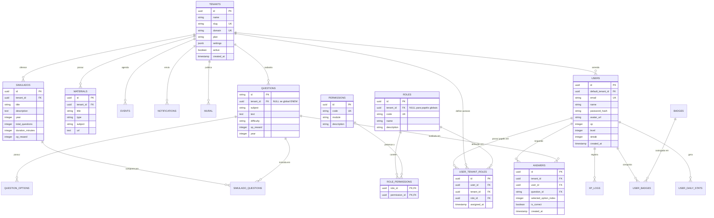
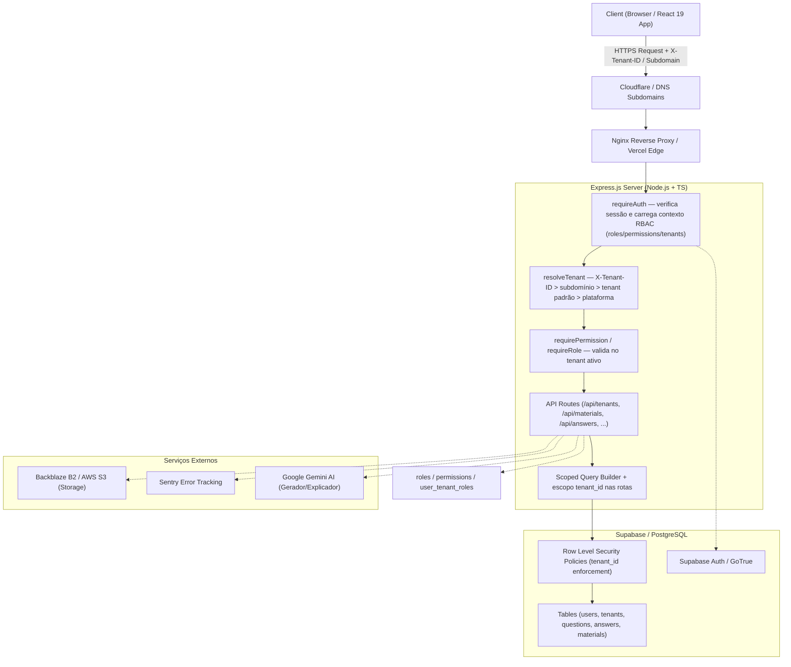
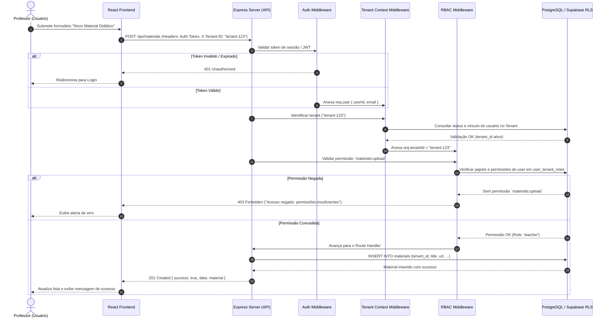
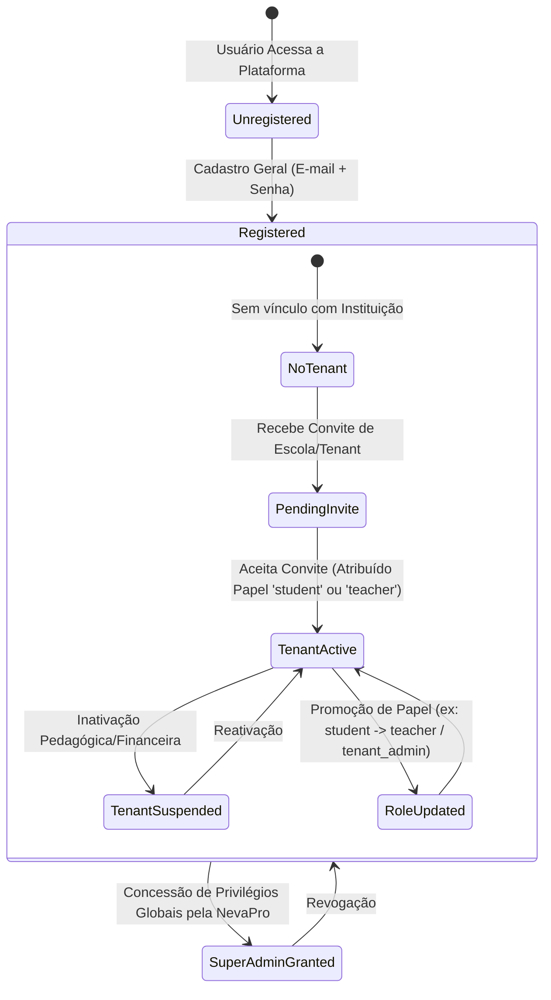
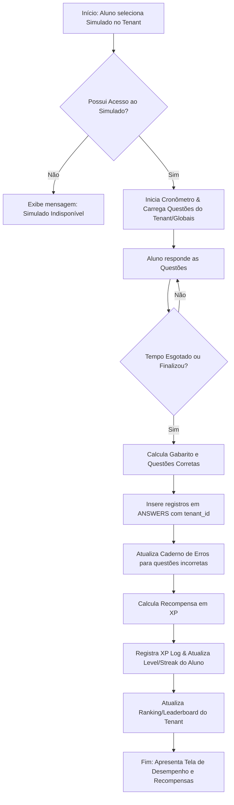
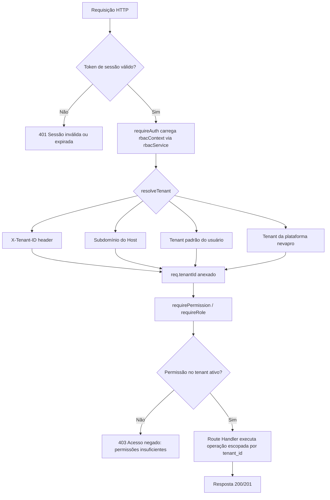
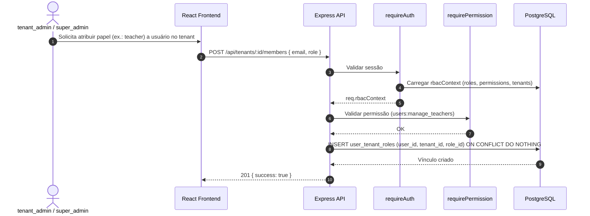

# Diagramas UML - Plataforma NevaPro (Multi-Tenancy & RBAC)

Este documento contém a especificação UML completa da plataforma **NevaPro**, contemplando o modelo de **Multi-Tenancy**, a estrutura de **RBAC (Role-Based Access Control)**, o pipeline de requisições e o ciclo de vida de entidades.

---

## 1. Diagrama de Entidade-Relacionamento (ERD / Class Diagram)

O diagrama abaixo apresenta o modelo de dados unificado com suporte a arrendamento múltiplo (`tenants`), papéis (`roles`), permissões (`permissions`) e atribuições de usuários (`user_tenant_roles`).

> ✅ **Status (13/08/2026):** Modelo implementado em `supabase/schema.sql` e `supabase/migrations/20260813_rbac_multi_tenancy.sql`, incluindo as colunas `tenant_id` nas tabelas escopadas (`users`, `admin_users`, `materials`, `events`, `notifications`, `mural`, `simulados`, `questions`, `answers`, `user_badges`, `user_daily_stats`, `xp_logs`, `user_study_tasks`, `user_tri_scores`).

---

## 2. Diagrama de Arquitetura de Sistema (Component / System Context)

Visualização da infraestrutura e fluxo de dados entre Clientes (Web/Mobile), Middlewares de Segurança, Camada de Aplicação e Banco de Dados Supabase/PostgreSQL com RLS.

---

## 3. Diagrama de Sequência: Autenticação Multi-Tenant & Verificação RBAC

Demonstra o fluxo passo a passo de validação de tenant e autorização por papéis ao realizar uma requisição à API (ex: publicação de novo material didático).

---

## 4. Diagrama de Estado: Ciclo de Vida do Usuário & Vínculo com Tenant

---

## 5. Diagrama de Atividade: Resolução de Simulado e Processamento de XP

---

## 6. Diagrama de Componentes: Pipeline de Autorização (RBAC + Multi-Tenancy)

Fluxo real implementado nos middlewares `requireAuth`, `resolveTenant` e `requirePermission`.

---

## 7. Diagrama de Sequência: Gestão de Tenants e Atribuição de Papéis

Fluxo de `POST /api/tenants/:id/members` (atribuir papel a usuário).

